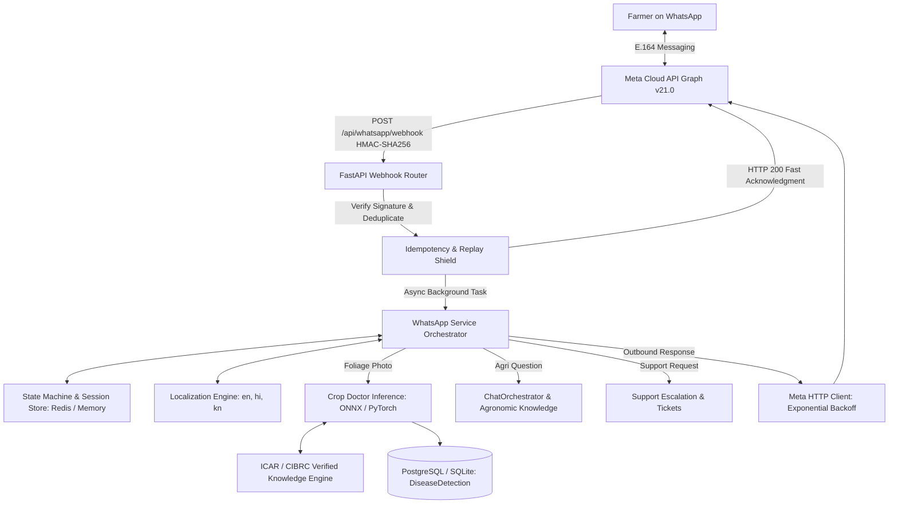

# WhatsApp Business Platform Integration — Architecture & System Design

## 1. Overview
The KisaanBuddy WhatsApp Business integration brings AI-driven agronomic assistance directly to farmers on WhatsApp using Meta's official WhatsApp Business Cloud API (v21.0). Farmers can interact in English, Hindi (`हिन्दी`), or Kannada (`ಕನ್ನಡ`), diagnose crop foliar diseases by sending photographs, ask open-ended agricultural questions, retrieve live mandi prices and weather advisories, explore verified government schemes, and escalate queries to human experts.

---

## 2. Core Architectural Pillars

### 2.1 Fast Webhook Ingestion & Background Task Processing
Meta strictly requires incoming webhooks to return `HTTP 200 OK` within 3 seconds. To prevent timeouts caused by heavy vision model inference or external network calls:
1. `POST /api/whatsapp/webhook` verifies the `X-Hub-Signature-256` HMAC header.
2. Checks event idempotency (`deduplicator.is_duplicate(msg.id)`).
3. Queues message turn processing via FastAPI `BackgroundTasks`.
4. Returns `{"status": "accepted"}` immediately to Meta (< 150ms).

### 2.2 Security, SSRF Prevention & Link Verification
- **HMAC Signature Verification:** All incoming requests are signed by Meta using the App Secret (`X-Hub-Signature-256`). Payloads with invalid or missing signatures are rejected with `HTTP 403 Forbidden`.
- **SSRF Safe Media Downloads:** When farmers send foliage photos, Meta provides a media download URL. To prevent Server-Side Request Forgery, `is_safe_media_url` enforces a strict domain allowlist (`lookaside.fbsbx.com`, `graph.facebook.com`, `*.fbcdn.net`).
- **Expiring Contextual Tokens:** When linking to the web app for private diagnoses or personalized dashboards, URLs contain HMAC-SHA256 signed expiring tokens (`/disease?diagnosis_id=42&token=...`).

### 2.3 Conversation State Machine
The conversational engine maintains an explicit state machine:
- `NEW_USER`: Welcome and language prompt.
- `LANGUAGE_SELECTION`: Selection of English, Hindi, or Kannada.
- `MAIN_MENU`: 6 interactive menu options.
- `CROP_DOCTOR_WAITING_FOR_IMAGE`: Expecting foliage photograph.
- `CROP_DOCTOR_PROCESSING`: Analyzing leaf image.
- `CROP_DOCTOR_RESULT`: Output diagnosis + link to full diagnosis.
- `AGRICULTURAL_QUESTION`: Natural language agronomic advice.
- `WEBSITE_REDIRECTION`: Contextual web links.
- `HUMAN_SUPPORT`: Escalation ticket registered.
- `SESSION_EXPIRED`: Inactivity timeout handling (24 hours).

Universal commands (`menu`, `language`, `support`, `0`) are active from all states.

### 2.4 Multilingual Support
System messages, interactive menus, button titles, and error guidance are localized across:
- **English (`en`)**
- **Hindi (`hi` — हिन्दी)**
- **Kannada (`kn` — ಕನ್ನಡ)**

New Indian regional languages (Marathi, Telugu, Tamil, Bengali, Punjabi, Gujarati) can be added simply by defining their dictionary entries in `services/whatsapp/localization.py`.

### 2.5 Crop Doctor Inference & Agricultural Grounding
- Reuses the existing production `DiseaseClassifier` ONNX model and `inference_engine.predict_disease`.
- Grounded in authentic ICAR (Indian Council of Agricultural Research) and CIBRC (Central Insecticides Board & Registration Committee) knowledge profiles.
- Persists diagnosis into the existing `DiseaseDetection` database model so that both WhatsApp and the website share the same diagnostic history.
- Never fabricates confidence values or unverified pesticide treatments.
