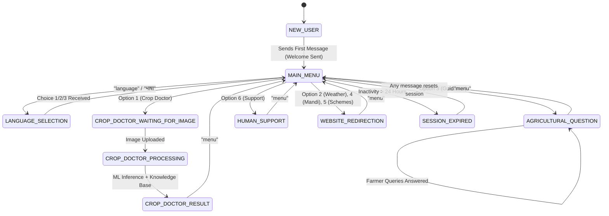

# WhatsApp Conversation Flows & State Transitions

This document specifies the exact conversational journeys and state transitions designed for Indian farmers.

---

## 1. Flow Diagrams



---

## 2. Detailed Conversation Scenarios

### Flow A: Welcome & Language Selection
```text
Farmer: Namaste
KisaanBuddy: 
Namaste! Welcome to KisaanBuddy.
Your farming assistant is here to help you.
Choose what you need help with:

1. Crop Doctor 🌿
2. Weather Updates 🌤️
3. Crop Guidance 🌱
4. Market Prices 📊
5. Govt Schemes 🏛️
6. Talk to Support 👨‍🌾

Type 'menu' anytime to return here.

Farmer: भाषा
KisaanBuddy:
🌐 भाषा चयन / Language Selection
कृपया अपनी पसंदीदा भाषा चुनें:
1. English
2. हिन्दी (Hindi)
3. ಕನ್ನಡ (Kannada)

Farmer: 2
KisaanBuddy:
✅ भाषा बदलकर हिन्दी कर दी गई है। स्वागत है! शुरू करने के लिए 'menu' लिखें।
```

---

### Flow B: Crop Doctor Foliage Photo Diagnosis
```text
Farmer: 1
KisaanBuddy:
🌾 क्रॉप डॉक्टर — फसल रोग निदान
कृपया प्रभावित पौधे की पत्ती, तने या फल की स्पष्ट फोटो भेजें।
• रोशनी अच्छी होनी चाहिए
• रोग या धब्बे वाले भाग पर फोकस करें
मुख्य मेनू पर लौटने के लिए 'menu' लिखें।

Farmer: [Uploads clear foliage photograph of tomato leaf with early blight]
KisaanBuddy:
🔬 किसानबडी एआई विज़न द्वारा आपकी फसल की फोटो का विश्लेषण किया जा रहा है...

KisaanBuddy:
🌿 क्रॉप डॉक्टर जांच परिणाम (आईडी: #142)
• फसल: Tomato
• पहचाना गया रोग: Early Blight
• मॉडल विश्वास: 89% (✅ सटीक परिणाम)

📋 लक्षण व प्राथमिक उपचार:
• पत्तियों पर गहरे भूरे रंग के छल्लेदार धब्बे।
• प्रभावित पत्तियों को तुरंत तोड़कर खेत से दूर नष्ट करें।

🛡️ सिफारिश:
• स्वीकृत उपचार: Mancozeb 75% WP @ 2g/litre water.

🔍 पूरी रिपोर्ट व फोटो देखें:
https://kisaanbuddy.com/disease?diagnosis_id=142&token=...

मेनू पर लौटने के लिए 'menu' लिखें।
```

---

### Flow C: Agricultural Question-Answering
```text
Farmer: टमाटर में फूल झड़ने से कैसे रोकें?
KisaanBuddy:
🌱 कृषि मार्गदर्शन: Tomato — Blossom Drop Prevention
• लक्षण: तापमान अधिक होने या बोरॉन/कैल्शियम की कमी से फूल झड़ते हैं।
• उपचार सिफारिश:
  - सिंचाई नियमित रखें, जलभराव न होने दें।
  - प्लानोफिक्स (Planofix) 1 ml प्रति 4.5 लीटर पानी में मिलाकर फूल आने पर छिड़कें।
  - सूक्ष्म पोषक तत्व (Micronutrient mixture) का हल्का छिड़काव करें।

📌 सूचना: यह सलाह ICAR-CIBRC सत्यापित डेटा पर आधारित है। रासायनिक छिड़काव से पहले कृषि विस्तार अधिकारी से सलाह लें।

मुख्य मेनू के लिए 'menu' लिखें।
```

---

### Flow D: Live Mandi & Market Prices
```text
Farmer: 4
KisaanBuddy:
📊 मंडी भाव और बाजार मूल्य
देशभर की APMC मंडियों के ताज़ा फसल भाव और रुझान देखें।
लाइव मंडी भाव देखने के लिए लिंक खोलें:
https://kisaanbuddy.com/mandi?token=...

मुख्य मेनू के लिए 'menu' लिखें।
```

---

### Flow E: Human Expert Escalation
```text
Farmer: 6
KisaanBuddy:
👨‍🌾 सहायता अनुरोध दर्ज किया गया
आपका अनुरोध सफलतापूर्वक दर्ज कर लिया गया है।
• टिकट आईडी: KB-SUP-20261106-482B
• स्थिति: खुला (OPEN)

किसानबडी सहायता टीम या स्थानीय कृषि विज्ञान केंद्र (KVK) विशेषज्ञ को सूचित कर दिया गया है। वे जल्द ही आपसे संपर्क करेंगे।

मुख्य मेनू के लिए 'menu' लिखें।
```
