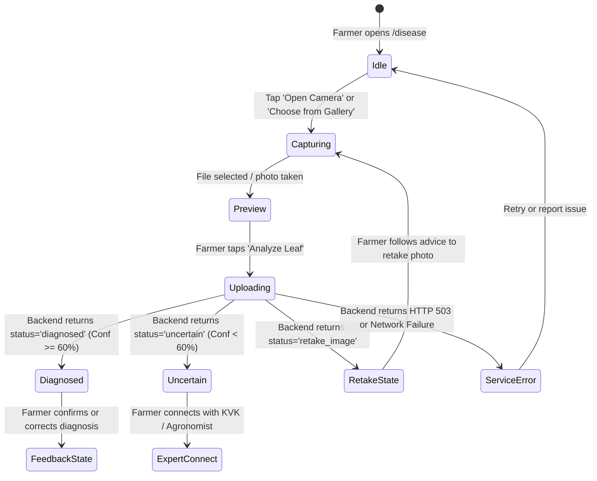

# Frontend Workflow & User Experience Specification

**Project:** KisaanBuddy Crop Doctor AI Rebuild  
**Component:** `frontend-next/src/app/disease/DiseaseClient.tsx` & `/api/disease/predict/route.ts`  

---

## 1. Core Principles

The Crop Doctor user experience is designed specifically for rural farmers using mobile devices in varying field lighting conditions:
1. **Immediate Feedback:** Real-time visual confirmation upon camera capture or file selection.
2. **Transparent Confidence:** No inflated or fabricated confidence scores. If confidence is below 60%, the UI clearly marks the diagnosis as *Uncertain* and surfaces an "Ask an Expert" action.
3. **Actionable Retake Guidance:** If a photo is blurry or dark, clear vernacular guidance explains how to position the camera for a clear shot.
4. **Offline / Backend Failure Resilience:** When the inference backend is offline, the client cleanly informs the user that diagnostic services are temporarily unavailable (HTTP 503 `model_unavailable`) rather than producing synthetic or hallucinated results.

---

## 2. Interaction State Machine

---

## 3. UI Treatment of Diagnostic States

### 3.1 State: `diagnosed` (Confidence $\ge 60\%$)
- **Visuals:** Emerald badge indicating verified visual diagnosis.
- **Display:** Primary disease name with vernacular translation (Hindi/English). Calibrated percentage displayed prominently.
- **Alternatives Drawer:** Collapsible panel showing 2nd and 3rd candidate conditions with confidence bars.
- **Treatment Cards:** Organised into *Immediate Cultural Practices*, *Organic Treatments*, and *Recommended Chemical Options*.

### 3.2 State: `uncertain` (Confidence $< 60\%$)
- **Visuals:** Amber advisory banner: *"Visual symptoms are inconclusive."*
- **Display:** Shows top predicted possibility labeled as *Tentative Indicator*.
- **Primary Action:** *"Connect with an Agronomist / Krishi Vigyan Kendra"* with pre-filled case history.

### 3.3 State: `retake_image`
- **Visuals:** Warm alert banner indicating image quality issue.
- **Actionable Advice:**
  - *Blurry:* "Hold camera steady and tap the leaf to focus before taking the shot."
  - *Dark:* "Move into daylight or turn away from shadows."
  - *Glare:* "Shield the leaf from harsh direct sun glare."
- **One-tap Action:** *"Take Another Photo"*.
