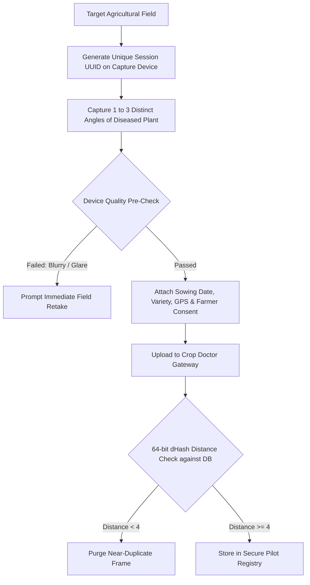

# KisaanBuddy Crop Doctor: 500+ Indian Field Image Collection & Sampling Protocol

**Document Version:** 2.0.0  
**Program Objective:** Construct India's High-Fidelity, Session-Isolated Agricultural Vision Benchmark (500+ Verified Field Photographs)  
**Lead Architect:** Senior Agricultural Vision Specialist & ML QA Lead  
**Date:** November 7, 2026  

---

## 1. Objective & Target Scope

The goal of this protocol is to collect, verify, deduplicate, and curate **500+ authentic field photographs** across the 17 canonical Crop Doctor plant pathology classes. Unlike laboratory benchmark images (such as PlantVillage bench photography), all images in this campaign must be captured directly from agricultural fields across varied Indian agro-climatic zones under natural daylight, real background clutter, and diverse disease stages.

---

## 2. Target Sampling Quotas (500+ Images Across 17 Classes)

Each class has a defined quota to avoid class imbalance. A minimum of **30 images per class** is required, with higher allocations for high-frequency epidemic diseases (e.g. Late Blight, Cotton Leaf Curl, Tomato Yellow Leaf Curl).

| Class ID | Botanical & Pathological Name | Target Quota | Minimum Unique Fields | Minimum Severity Distribution (Early / Mid / Severe) |
| :--- | :--- | :---: | :---: | :---: |
| `apple_scab` | Apple Scab (*Venturia inaequalis*) | 30 | 5 | 10 / 10 / 10 |
| `apple_black_rot` | Apple Black Rot (*Diplocarpon mali* / *Botryosphaeria*) | 30 | 5 | 10 / 10 / 10 |
| `apple_cedar_rust` | Apple Cedar Rust (*Gymnosporangium*) | 30 | 5 | 10 / 10 / 10 |
| `apple_healthy` | Apple Asymptomatic / Healthy Foliage | 30 | 5 | N/A (30 healthy) |
| `corn_cercospora_leaf_spot` | Corn Gray Leaf Spot (*Cercospora zeae-maydis*) | 30 | 6 | 10 / 10 / 10 |
| `corn_common_rust` | Corn Common Rust (*Puccinia sorghi*) | 30 | 6 | 10 / 10 / 10 |
| `corn_northern_leaf_blight` | Corn Northern Leaf Blight (*Exserohilum turcicum*) | 30 | 6 | 10 / 10 / 10 |
| `corn_healthy` | Corn Asymptomatic / Healthy Foliage | 30 | 5 | N/A (30 healthy) |
| `grape_black_rot` | Grape Black Rot (*Guignardia bidwellii*) | 30 | 5 | 10 / 10 / 10 |
| `grape_esca` | Grape Esca / Black Measles | 30 | 5 | 10 / 10 / 10 |
| `grape_leaf_blight` | Grape Leaf Blight (*Pseudocercospora vitis*) | 30 | 5 | 10 / 10 / 10 |
| `grape_healthy` | Grape Asymptomatic / Healthy Foliage | 30 | 5 | N/A (30 healthy) |
| `potato_early_blight` | Potato Early Blight (*Alternaria solani*) | 35 | 8 | 12 / 12 / 11 |
| `potato_late_blight` | Potato Late Blight (*Phytophthora infestans*) | 40 | 8 | 15 / 15 / 10 |
| `potato_healthy` | Potato Asymptomatic / Healthy Foliage | 30 | 5 | N/A (30 healthy) |
| `tomato_early_blight` | Tomato Early Blight (*Alternaria solani*) | 35 | 8 | 12 / 12 / 11 |
| `tomato_late_blight` | Tomato Late Blight (*Phytophthora infestans*) | 40 | 8 | 15 / 15 / 10 |
| **Total Campaign Quota** | **17 Canonical Crop Doctor Classes** | **530 Images** | **96+ Fields** | **Balanced Stage Distribution** |

---

## 3. Geographic & Agro-Climatic Diversity

Data collection must span at least three major agro-climatic zones in India to capture variations in soil coloration, diurnal illumination, and regional crop varieties:

1. **Zone 1: Western & Central Plateau (Maharashtra / Madhya Pradesh):**
   - Districts: Nashik, Pune, Aurangabad, Indore.
   - Primary Focus: Grape, Tomato, Potato, Corn.
   - Background Elements: Black cotton soil, red loamy soil, drip irrigation foliage.
2. **Zone 2: Indo-Gangetic Plains (Punjab / Uttar Pradesh / Bihar):**
   - Districts: Jalandhar, Agra, Varanasi, Patna.
   - Primary Focus: Potato Late Blight, Tomato Early Blight, Corn.
   - Background Elements: Alluvial soil, dense canopy, morning mist/dew conditions.
3. **Zone 3: Northern Hill Region (Himachal Pradesh / Jammu & Kashmir):**
   - Districts: Shimla, Kullu, Baramulla.
   - Primary Focus: Apple Scab, Black Rot, Cedar Rust, Apple Healthy.
   - Background Elements: Hill terraces, overcast/diffuse mountain illumination.

---

## 4. Sampling Protocol & Session Isolation Rules

To prevent data contamination and guarantee evaluation integrity:



### Strict Anti-Leakage Constraints:
1. **Cryptographic Session Grouping:** All images captured during a single plant inspection must share the same `session_id`.
2. **Zero Session Contamination:** The dataset export engine splits data strictly by `session_id`. No images from the same session or plant are ever permitted in both train and evaluation splits.
3. **Perceptual Deduplication (dHash $\ge 4$):** Any frame having a difference hash hamming distance $< 4$ from an existing image in the database is automatically purged as a burst duplicate.
4. **Physical Plant Limitation:** Maximum 3 photographs per individual plant (e.g. adaxial view, abaxial view, whole leaf in context).

---

## 5. Metadata Specification

Every accepted image manifest entry MUST record:

```json
{
  "sample_id": "ADV-20261107-1001",
  "session_id": "sess_f83a1b02-58e1-4c59-a5e2-62b8c9d0e1a4",
  "image_path": "images/pilot/f83a1b02-58e1-4c59-a5e2-62b8c9d0e1a4.jpg",
  "dhash": "3f8b89c31e074a12",
  "sha256": "a3b98c12...64chars",
  "state": "Maharashtra",
  "district": "Nashik",
  "crop": "Tomato",
  "canonical_label": "tomato_early_blight",
  "disease_severity": "moderate",
  "leaf_surface": "adaxial",
  "growth_stage": "flowering",
  "review_outcome": "confirmed_correct",
  "expert_name": "Dr. Kavita Deshmukh",
  "expert_designation": "KVK Senior Plant Pathologist",
  "consent_version": "v1.0",
  "consent_for_research": true
}
```

---

## 6. Dataset Quality Gating & Rejection Criteria

An observation is rejected and excluded from the ML benchmark if:
- **Corrupt / Unreadable File:** Truncated header or unsupported compression.
- **Excessive Motion Blur:** Laplacian variance $< 18.0$.
- **Extreme Illumination:** Mean pixel brightness $< 20$ (underexposed) or $> 238$ (washed out/overexposed).
- **Insufficient Foliage:** Vegetation pixel ratio $< 5\%$.
- **Ambiguous Pathology:** Agronomist marked `uncertain_diagnosis` or `unable_to_assess_photograph`.
- **Missing Consent:** Farmer opted out or did not record explicit research consent.

---

## 7. Sign-off & Execution Schedule

- **Week 1–2:** KVK onboarding, agronomist dashboard dry-runs, and pilot app distribution to participating FPO leads.
- **Week 3–6:** Field photography mobilization across Maharashtra and UP (target: 350 images).
- **Week 7–8:** Northern hill zone collection (Apple classes) and final quota fulfillment (target: 180 images).
- **Week 9:** Run automated pipeline `export_pilot_dataset.py`, audit session splits, and certify the final benchmark dataset.
