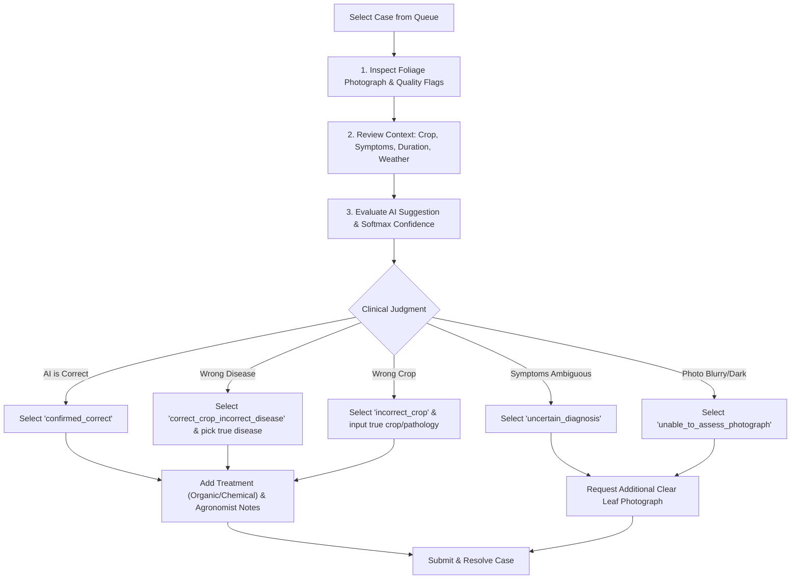

# KisaanBuddy Crop Doctor: Agronomist & Field Expert Operating Guide

**Target Audience:** Krishi Vigyan Kendra (KVK) Agronomists, Agricultural Extension Officers, Plant Pathologists  
**System Module:** Crop Doctor Expert Triage Dashboard (`/crop-doctor/expert`)  
**Document Version:** 1.0.0 (Field Pilot Edition)  

---

## 1. Introduction & Mission

As an agricultural expert in the KisaanBuddy Supervised Pilot, your role is pivotal:
1. Provide accurate, practical advisory to Indian farmers to protect their harvest and reduce unnecessary chemical pesticide use.
2. Provide ground-truth clinical annotations that will train and validate the next generation of Crop Doctor computer vision foundation models.

---

## 2. Accessing the Expert Dashboard

1. **Authentication:**
   - Navigate to `https://<your-staging-domain>/crop-doctor/expert` (or `http://localhost:3000/crop-doctor/expert` in local pilot testing).
   - Log in using your registered agronomist credentials (`role: expert` or `role: agronomist`).
   - If unauthorized (ordinary farmer or logged-out), the system returns an access denial error (HTTP 401/403).

2. **Dashboard Layout:**
   - **Triage Queue:** Displays unreviewed pending cases sorted by priority (`high` priority flags at the top).
   - **Filter Controls:** Filter by Crop (e.g. Tomato, Potato, Pepper, Corn), District/State, or Status (`pending`, `in_review`, `resolved`).
   - **Summary Counter:** Shows your reviewed count and outstanding cases.

---

## 3. Triage & Clinical Review Procedure

When you select an observation from the queue:

### Detailed Review Steps:

### Step 1: Image Quality Inspection
- Check the displayed image in full resolution.
- Review automated quality metrics:
  - **Blur Score:** $< 18.0$ indicates motion blur or soft focus.
  - **Brightness:** Values $< 20$ (underexposed) or $> 238$ (glare/overexposed).
  - **Vegetation Ratio:** Percentage of frame occupied by foliage.
- If the photograph is too poor to identify pathological structures (e.g. pycnidia, concentric rings, pustules), select `unable_to_assess_photograph` and ask the farmer to retake the photo in daylight.

### Step 2: Contextual Farmer Data
- Note the crop variety, sowing date, affected acreage, and duration of symptoms.
- Check recent weather conditions (e.g., continuous rain favors Downy Mildew and Late Blight; dry heat favors Spider Mites and Powdery Mildew).

### Step 3: Diagnostic Decision & Standard Outcome Codes
You must select exactly one of the standardized outcome codes:

1. **`confirmed_correct`:** The AI correctly recognized both the crop and disease.
2. **`correct_crop_incorrect_disease`:** Crop is correct, but AI misdiagnosed the pathology (e.g. AI predicted Tomato Early Blight, but true condition is Tomato Septoria Leaf Spot). Select the true condition from the dropdown.
3. **`incorrect_crop`:** AI misidentified the crop species entirely. Correct both the crop name and condition.
4. **`uncertain_diagnosis`:** Visual symptoms are inconclusive or secondary saprophytic growth obscures primary etiology.
5. **`unable_to_assess_photograph`:** Blurry, underexposed, or distant photo.

### Step 4: Integrated Disease Management (IDM) Prescription
When prescribing treatments, adhere strictly to ICAR and CIBRC approved guidelines:
- **Preventative / Cultural Control:** Crop rotation, field sanitation, drainage improvement, removal of infected crop residues.
- **Biological / Organic Control:** Trichoderma viride, Pseudomonas fluorescens, or neem seed kernel extract (NSKE 5%).
- **Chemical Control:** Only prescribe registered active ingredients (e.g., Mancozeb 75% WP, Copper Oxychloride 50% WP) with explicit dosage, dilution rates, and pre-harvest intervals (PHI).
- **Safety Advisory:** Wear personal protective equipment (PPE) and avoid spraying during high wind or peak pollinator hours.

### Step 5: Final Submission
Click **"Submit Expert Review"**. The record is stamped with your reviewer ID, timestamp, and confirmed ground truth, immediately updating the farmer's case status to `resolved`.

---

## 4. Ethical & Data Integrity Mandates

- **Do Not Guess:** If a diagnosis is uncertain, never confirm an AI prediction just to clear the queue. Mark it `uncertain_diagnosis`. A false positive can cause a farmer to waste thousands of rupees on inappropriate fungicides.
- **Auditability:** Every submission is permanently logged in `AdvisoryNotificationLog` with your user ID.
- **Privacy:** Do not copy or store farmer contact information outside the secure portal.
