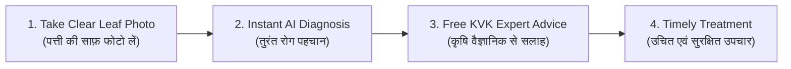

# KisaanBuddy Crop Doctor: Farmer Field Guide & Photography Manual
# किसानबड्डी क्रॉप डॉक्टर: किसान मार्गदर्शिका एवं फोटो निर्देश

**Welcome to the KisaanBuddy Supervised Pilot!**  
This guide will help you get accurate crop disease diagnosis and free advice from agricultural scientists directly on your mobile phone.

---

## 1. How Crop Doctor Works (क्रॉप डॉक्टर कैसे काम करता है)

1. **Take a Photo:** Click a clear close-up picture of the diseased crop leaf using your phone camera.
2. **Instant Check:** Our AI vision system inspects the spots, lesions, and discoloration.
3. **Scientist Review:** If the disease is serious or symptoms are unclear, your photo is sent to a Krishi Vigyan Kendra (KVK) agronomist for verification.
4. **Actionable Solution:** You receive approved, low-cost organic and chemical management tips.

---

## 2. Photography Guidelines: How to Take an Ideal Photo
## (सही फोटो लेने के आसान नियम)

An accurate diagnosis depends completely on the quality of your photograph. Follow these 5 golden rules:

| Rule | What to Do (क्या करें) | What to Avoid (क्या न करें) |
| :--- | :--- | :--- |
| **1. Daylight Lighting** (प्राकृतिक रोशनी) | Take photos in clear daylight (morning or late afternoon). | Do not shoot at night with harsh flash or in deep shade. |
| **2. Fill the Frame** (पत्ती को केंद्र में रखें) | Keep the camera 15 to 20 cm away. The diseased leaf should cover **70% of the screen**. | Do not take wide photos of the whole field where leaves look tiny. |
| **3. Focus on Disease Spots** (धब्बों पर फोकस करें) | Tap your phone screen directly on the diseased lesion before clicking. Ensure edges of spots are sharp. | Avoid blurry photos caused by moving hands or shaking in the wind. |
| **4. Single Leaf Background** (साफ पृष्ठभूमि) | Hold the leaf steady with your hand or place your palm behind it to block soil/weeds. | Avoid cluttered backgrounds with dry soil, plastic bags, or mixed weeds. |
| **5. Capture Both Sides** (पत्ती के दोनों पहलू) | If white powder or rust pustules are underneath the leaf, take a second photo of the reverse side. | Do not upload completely dry, dead, or rotten brown stems. |

---

## 3. Understanding the Diagnostic Score (नतीजों को समझें)

When the AI gives you a result, look at the **Diagnostic Certainty Meter**:

- 🟢 **Green (High Certainty — 60% or higher):**  
  Symptoms match known disease patterns strongly. Follow the recommended cultural and biological measures immediately.
- 🟡 **Yellow (Moderate Certainty — 40% to 59%):**  
  Symptoms are partially visible or in early stages. Click **"Request Free Expert Review"** to have an agronomist verify the diagnosis.
- 🔴 **Red (Uncertain / Need Expert Review — Below 40%):**  
  Symptoms are unusual or image is unclear. The system will automatically route your case to a local KVK expert. **Do not buy chemical pesticides until an expert reviews your photo.**

---

## 4. How to Request Expert Review (वैज्ञानिक से सलाह कैसे लें)

1. On the diagnosis screen, tap **"Ask an Expert" (विशेषज्ञ से सलाह लें)**.
2. Enter your crop variety, how many days symptoms have appeared, and your village or district.
3. Check the **"I agree to share this photo for agricultural research"** box.
4. Click **"Submit Case"**.
5. You will receive a unique Case ID (e.g. `ADV-20261107-1001`). You can check your case status anytime under **"My Crop History"**.
6. Once the KVK scientist reviews your case, you will receive an SMS or notification with the confirmed diagnosis and dosage instructions.

---

## 5. Your Privacy & Data Rights (आपकी गोपनीयता एवं अधिकार)

- **Phone Number Protection:** Your personal phone number is never shown publicly. It is strictly masked (`******3210`) on all dashboards.
- **Research Consent:** Your photos help improve the Crop Doctor system for other Indian farmers.
- **Right to Withdraw:** You can withdraw your research consent or request deletion of your photos at any time by contacting your local extension coordinator or tapping "Withdraw Consent" in your case history.
- **Zero Cost:** The advisory service provided by KVK experts during this pilot is completely free of charge.

---

*For urgent field queries, visit your nearest Krishi Vigyan Kendra (KVK) or contact the Kisan Call Centre (Toll-Free: 1800-180-1551).*
