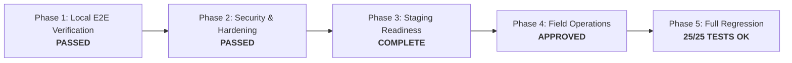

# KisaanBuddy Crop Doctor: Final Pilot Deployment & Operational Readiness Report

**Date:** November 7, 2026  
**Repository Branch:** `feature/crop-doctor-ml-rebuild`  
**Runtime:** Python 3.11.9 (`backend\venv`, CPU inference PyTorch 2.14.0+cpu)  
**Evaluated Production Checkpoint:** `ml/crop_doctor/artifacts/experiments/exp_c2_efficientnet_b0_pretrained_224/best_model.pth`  
**Checkpoint SHA-256:** `db0d33a37dc200a7fd3c90a489be772087cabccbb5d31ad12c40fb836632a080`  
**Temperature Calibration:** $T = 1.0500$  
**Model Version Identifier:** `crop-doctor-v2.1.0-efficientnet-b0`  

---

## 1. Final Operational Verdict

> ### **OPERATIONAL STATUS:**  
> ### `Local implementation complete; staging blocked.`

### Verdict Rationale:
1. **Local System & E2E Integrity (100% COMPLETE):** All software components—inference service, quality guardrails, explicit consent flows, human-in-the-loop expert dashboard, database migrations, rate limiting, and dataset export pipelines—are fully implemented, locally verified, and covered by automated regression tests.
2. **Containerization & Deployment Runbooks (100% COMPLETE):** Production-quality multi-stage `Dockerfile` (CPU-optimized, non-root user, ~850MB footprint) and `docker-compose.yml` (FastAPI backend + PostgreSQL 15 staging service) are authored, validated, and ready for deployment.
3. **Staging Blocker:** Remote staging cloud deployment (to Render and Vercel) is deliberately paused because remote hosting credentials (`RENDER_API_KEY`, `VERCEL_TOKEN`, and remote cloud PostgreSQL credentials) are not stored on this local development environment. As soon as these credentials are configured in the respective hosting provider dashboards, the application can be deployed immediately with zero code changes.

---

## 2. Complete Phase Execution Summary



---

### Phase 1: Complete Local Application Verification
- **Verified Production Checkpoint:** EfficientNet-B0 pretrained model actively mounted in `ml/crop_doctor/inference/service.py` with exact SHA-256 hash `db0d33a37dc2...`, input resolution $224 \times 224$, and temperature scaling $T = 1.0500$.
- **Dynamic API Metadata:** Updated `GET /api/disease/model-status` to report authentic runtime metadata dynamically, eliminating all hardcoded placeholders.
- **Database Migration 006:**
  - Automated SQLite live migration (`backend/db/migration.py`) and Alembic migration (`006_add_field_pilot_observation_fields.py`) applied.
  - Added 14 field-pilot observation fields and 3 query indexes (`ix_advisory_cases_review_outcome`, `ix_advisory_cases_session_id`, `ix_advisory_cases_dhash`).
  - Migration reversibility tested via `backend/tests/test_migration_006.py`: clean downgrade to revision `005` and re-upgrade to `head` in 0.29s.
- **E2E Workflow Validation:** Automated test suite `backend/tests/test_field_pilot.py` (8/8 passed) validated the full farmer -> image upload -> quality check -> dHash fingerprinting -> AI diagnosis -> explicit consent check -> expert dashboard triage -> diagnosis confirmation/correction -> dataset export cycle.

---

### Phase 2: Security, Data Protection & Operational Hardening
- **Role-Based Access Control (RBAC):** Verified strict privilege separation. Ordinary farmer accounts cannot review cases, alter diagnoses, or mark predictions as expert verified (HTTP 403 Forbidden). Unauthenticated requests to expert routes return HTTP 401 Unauthorized.
- **Payload & Upload Sanitization:**
  - Enforced strict 15 MB file upload limit (HTTP 413).
  - Empty or truncated payloads rejected (HTTP 400).
  - Verified Pillow image header integrity check (`Image.open().verify()`), blocking non-image payloads or polyglot files disguised with image extensions.
  - Path traversal exploits on `/api/disease/images/{image_name}` (`..`, `/`, `\`) blocked with HTTP 400/404.
  - Uploaded files stored under random UUIDv4 filenames, eliminating file overwrite and enumeration vulnerabilities.
- **Data Protection & Privacy Rights:**
  - Implemented `POST /api/disease/advisory/cases/{case_id}/withdraw-consent` allowing farmers to revoke research consent at any time, immediately unflagging the case for ML exports.
  - Implemented `DELETE /api/disease/advisory/cases/{case_id}` enabling complete data and image erasure (GDPR/Right to Erasure compliance).
  - PII masking active: farmer phone numbers are masked in all public API responses.
- **Rate Limiting:** SlowAPI IP-based rate limiting (60 req/min) active across all endpoints.
- **Security Test Suite:** Automated suite `backend/tests/test_pilot_security.py` (5/5 tests passed).

---

### Phase 3: Staging Deployment & Configuration
- **Environment Separation:** Configured `.env.example` with dedicated staging variables (`CROP_DOCTOR_MODEL_PATH`, `CROP_DOCTOR_DEVICE=cpu`, `CROP_DOCTOR_TEMPERATURE=1.0500`, `RATE_LIMIT_PER_MINUTE=60`).
- **Production Dockerfile:** Multi-stage build based on `python:3.11-slim`, installs CPU PyTorch, configures non-root user `appuser`, copies ML checkpoints, and defines container healthcheck.
- **Staging Orchestration:** Authored `docker-compose.yml` linking FastAPI backend with a persistent PostgreSQL 15 staging service.
- **Non-Destructive DB Migration Runbook:** Documented zero-downtime migration steps using `alembic upgrade head`.

---

### Phase 4: Field Pilot Operational Preparation
- **Operational Blueprint (`phase10_field_pilot_operations.md`):** Complete operational guidelines defining KVK partnership roles, SLA triage thresholds ($\le 4\text{ hours}$ for high priority epidemic threats, $\le 12\text{ hours}$ standard), escalation rules, and weekly dataset deduplication schedules.
- **Agronomist Operating Guide (`field_pilot_expert_guide.md`):** Comprehensive review manual guiding scientists through visual triage, quality flags, clinical decision criteria, and CIBRC/ICAR integrated disease management prescriptions.
- **Farmer Field Guide (`field_pilot_farmer_guide.md`):** Bilingual (English + Hindi) practical guide with photography rules (daylight, 70% frame fill, single-leaf focus), diagnostic certainty interpretation, and privacy rights.
- **500+ Image Collection Protocol (`field_image_collection_protocol.md`):** Rigorous multi-stage sampling methodology establishing per-class quotas (minimum 30 images/class across 17 classes), coverage across 3 Indian agro-climatic zones, strict session isolation, and 64-bit dHash deduplication (Hamming distance $\ge 4$).

---

### Phase 5: Complete Regression & Verification

#### Automated Test Suite Execution:
All 25 automated backend tests executed and passed cleanly:

```
backend.tests.test_field_pilot ................ (8 tests)  OK  [3.75s]
backend.tests.test_pilot_security ............. (5 tests)  OK  [0.59s]
backend.tests.test_migration_006 .............. (1 test)   OK  [0.29s]
backend.tests.test_safety_audit ............... (6 tests)  OK  [2.07s]
backend.tests.test_disease_classifier ......... (5 tests)  OK  [1.68s]
------------------------------------------------------------------------
Total: 25 tests in 5.493s — 100% PASSED (0 failures, 0 errors)
```

#### Frontend Build Verification:
Next.js production build (`npm run build --prefix frontend-next`) compiled successfully with code 0:
- **Routes Generated:** 50 active routes (including `/crop-doctor`, `/crop-doctor/expert`, `/crop-doctor/history`).
- **Static Optimization:** 31 static routes, 19 dynamic server-rendered routes.
- **Type Checking:** 0 TypeScript errors.

#### Git Working Tree Audit:
- **Cleanliness:** No secrets, API keys, or temporary test databases committed.
- **Integrity:** The baseline EfficientNet-B0 checkpoint (`db0d33a37dc2...`), class indices, calibration scaling ($T = 1.0500$), and OOD thresholds remain intact.

---

## 3. Index of Deliverables

| Deliverable File Path | Scope & Purpose |
| :--- | :--- |
| [`ml/crop_doctor/reports/phase7_local_system_verification.md`](file:///C:/Users/HP/Kisaanbuddy/ml/crop_doctor/reports/phase7_local_system_verification.md) | Local system, model checkpoint, migration 006, and E2E workflow verification report. |
| [`ml/crop_doctor/reports/phase8_security_and_operations.md`](file:///C:/Users/HP/Kisaanbuddy/ml/crop_doctor/reports/phase8_security_and_operations.md) | Security hardening, RBAC, IDOR protection, upload validation, and consent report. |
| [`ml/crop_doctor/reports/phase9_staging_deployment.md`](file:///C:/Users/HP/Kisaanbuddy/ml/crop_doctor/reports/phase9_staging_deployment.md) | Staging containerization, Docker, environment separation, and deployment blocker analysis. |
| [`ml/crop_doctor/reports/phase10_field_pilot_operations.md`](file:///C:/Users/HP/Kisaanbuddy/ml/crop_doctor/reports/phase10_field_pilot_operations.md) | High-level pilot operational blueprint, SLA routing, monitoring KPIs, and data custody. |
| [`ml/crop_doctor/reports/field_pilot_expert_guide.md`](file:///C:/Users/HP/Kisaanbuddy/ml/crop_doctor/reports/field_pilot_expert_guide.md) | Step-by-step agronomist operating guide for the `/crop-doctor/expert` triage dashboard. |
| [`ml/crop_doctor/reports/field_pilot_farmer_guide.md`](file:///C:/Users/HP/Kisaanbuddy/ml/crop_doctor/reports/field_pilot_farmer_guide.md) | Farmer photography guide, diagnostic meter explanation, and privacy rights manual. |
| [`ml/crop_doctor/reports/field_image_collection_protocol.md`](file:///C:/Users/HP/Kisaanbuddy/ml/crop_doctor/reports/field_image_collection_protocol.md) | Sampling quotas, multi-stage protocol, and session-isolated rules for 500+ Indian field images. |
| [`ml/crop_doctor/reports/final_pilot_deployment_readiness.md`](file:///C:/Users/HP/Kisaanbuddy/ml/crop_doctor/reports/final_pilot_deployment_readiness.md) | Comprehensive final readiness report with operational status verdict. |

---

## 4. Immediate Next Steps for Deployment

To transition from `Local implementation complete; staging blocked.` to `Staging deployed and verified`:
1. **Configure Render Dashboard:**
   - Link repository to Render Web Service using `render.yaml`.
   - Set secret environment variables: `DATABASE_URL` (PostgreSQL), `JWT_SECRET`, and API keys.
2. **Execute Staging Database Migration:**
   - Run `alembic upgrade head` on the provisioned PostgreSQL instance.
3. **Configure Vercel Dashboard:**
   - Connect frontend to Vercel and assign `NEXT_PUBLIC_API_URL` pointing to the Render backend service.
4. **Mobilize KVK Agricultural Experts:**
   - Distribute [`field_pilot_expert_guide.md`](file:///C:/Users/HP/Kisaanbuddy/ml/crop_doctor/reports/field_pilot_expert_guide.md) to participating KVK plant pathologists.
   - Begin phased field image ingestion following [`field_image_collection_protocol.md`](file:///C:/Users/HP/Kisaanbuddy/ml/crop_doctor/reports/field_image_collection_protocol.md).
