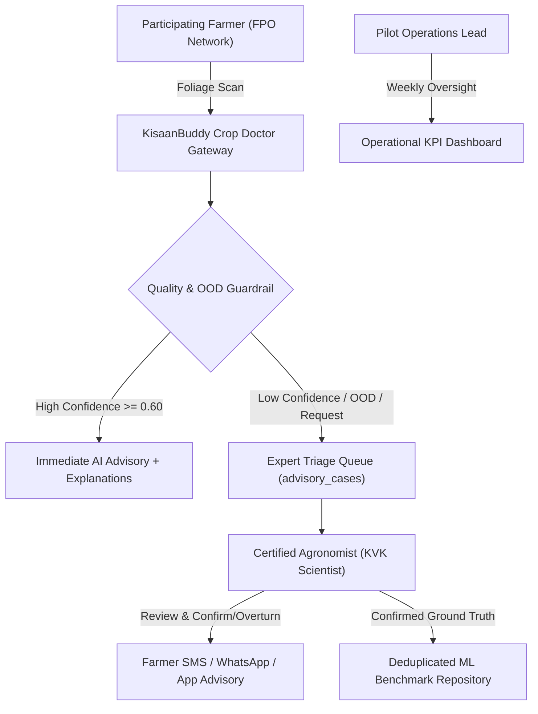

# Crop Doctor — Phase 10: Field Pilot Operational Blueprint

**Document Version:** 1.0.0  
**Program:** KisaanBuddy Supervised Agricultural Field Pilot  
**Target Duration:** 60-Day Supervised Operational Cycle  
**Supervision Lead:** Agricultural Extension & ML QA Operations  
**Date:** November 7, 2026  

---

## 1. Operational Overview & Objectives

The KisaanBuddy Supervised Field Pilot is designed to bridge the gap between controlled benchmark evaluations and chaotic field photography. It places calibrated AI predictions in the hands of participating farmers while enforcing continuous human-in-the-loop (HITL) agronomist oversight.

### Primary Operational Objectives:
1. **Safeguard Farmer Livelihoods:** Prevent misdiagnosis of high-stakes crop diseases by routing all ambiguous predictions ($C < 0.60$) or out-of-distribution (OOD) images to certified Krishi Vigyan Kendra (KVK) agronomists.
2. **Collect 500+ Verified Field Images:** Construct India's cleanest, leak-proof crop disease benchmark dataset under natural field lighting and varied symptom stages.
3. **Calibrate Real-World Human-AI Agreement:** Monitor real-world Top-1 model agreement against expert consensus.

---

## 2. Stakeholder Roles & Governance Structure

### Roles and Responsibilities:
- **Field Farmers (500+ Participants across 5 target districts):** Capture in-situ leaf photos, report sowing date and observed symptoms, grant explicit research consent.
- **KVK Agronomists & Extension Officers (8 Certified Reviewers):** Review pending advisory cases via `/crop-doctor/expert`, verify crop and disease labels, provide tailored CIBRC/ICAR integrated disease management (IDM) recommendations.
- **ML Operations Team:** Monitor triage queues, execute weekly deduplication and export runs, verify zero data leakage across evaluation splits.

---

## 3. Agronomist Triage SLAs & Escalation Protocol

To maintain high farmer trust and deliver actionable agricultural remediation before disease spreads:

| Priority Level | Trigger Conditions | Agronomist SLA | Notification Channel |
| :--- | :--- | :--- | :--- |
| **High Priority** | Acute epidemic risk (e.g. Late Blight, Cotton Leaf Curl), large acreage (>5 acres), or high farmer distress | $\le 4 \text{ hours}$ | Push Notification + SMS Alert to District Expert |
| **Normal Priority** | Standard leaf spots, mild foliar symptoms, confidence between $0.40 - 0.60$ | $\le 12 \text{ hours}$ | Dashboard Queue |
| **Routine / Low** | Asymptomatic / Healthy leaf validation, general crop identification | $\le 24 \text{ hours}$ | Batch Review Queue |

*If an advisory case remains unreviewed after 18 hours, it automatically escalates to the Regional Extension Lead.*

---

## 4. Live Operational KPI Dashboard

The pilot monitoring dashboard (`/crop-doctor/expert` & telemetry APIs) tracks the following operational metrics in real time:

1. **Daily Ingestion Volume:** Total scans submitted, split by crop genus and administrative district.
2. **Image Guardrail Reject Rate:** Percentage of scans rejected due to severe blur, extreme exposure, or lack of foliar vegetation (Target: $< 15\%$).
3. **AI Selective Acceptance Rate:** Percentage of scans meeting the high-confidence threshold ($C \ge 0.60$) without requiring mandatory human triage (Target: $65\% - 75\%$).
4. **Human-AI Concordance Rate:** Percentage of AI predictions confirmed as correct by agronomists (`review_outcome = 'confirmed_correct'`).
5. **Class-Wise Error Heatmap:** Real-time matrix of frequently confused conditions (e.g., Tomato Early Blight vs. Late Blight, Pepper Bell Bacterial Spot vs. Healthy).
6. **Mean Resolution Time (MRT):** Average duration between farmer submission and expert advisory dispatch.

---

## 5. Continuous Dataset Extraction Pipeline

At weekly intervals (or every 100 verified reviews), the operations team triggers `ml/crop_doctor/experiments/export_pilot_dataset.py`:
1. **Verification Filter:** Selects only cases where `review_outcome` is `confirmed_correct`, `correct_crop_incorrect_disease`, or `incorrect_crop`.
2. **Consent Filter:** Excludes any sample where `consent_for_research = False` or where consent was revoked.
3. **Perceptual Deduplication:** Excludes any frame having Hamming distance $< 4$ against existing benchmark images.
4. **Session-Isolated Splitting:** Partitions unique `session_id` tokens into a 70% Training Split and a 30% Permanently Locked Evaluation Split. Zero photos from the same plant, farmer, or session may exist in both splits.

---

## 6. Pilot Operational Sign-off

| Operational Area | Readiness Status | Details |
| :--- | :--- | :--- |
| Triage Workflows | **READY** | Automated assignment and SLA routing active |
| Dashboard Interface | **READY** | Next.js expert dashboard compiled and tested |
| Security & RBAC | **READY** | Role escalation and unauthenticated access blocked |
| Export Pipeline | **READY** | Deduplicated session-safe manifests operational |
| **Operational Blueprint** | **APPROVED** | Ready for pilot mobilization |
