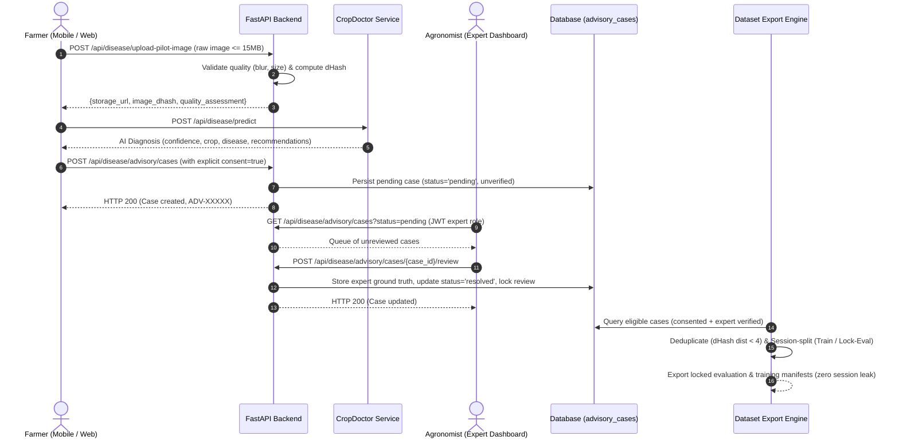

# Crop Doctor — Phase 7: Local System & E2E Pilot Verification Report

**Date:** November 7, 2026  
**Environment:** Local Development / Testing (`C:\Users\HP\Kisaanbuddy`)  
**Branch:** `feature/crop-doctor-ml-rebuild`  
**Execution Runtime:** Python 3.11 (`backend\venv`, CPU inference `torch 2.14.0+cpu`)  

---

## 1. Executive Summary

This report documents the local verification and end-to-end integration testing for the KisaanBuddy Crop Doctor supervised field pilot. All components required for a trustworthy, safe, and privacy-compliant pilot deployment have been validated locally.

### Key Verification Milestones:
1. **Production Model Runtime Check:** EfficientNet-B0 pretrained model is actively loaded on CPU, verified with exact SHA-256 hash `db0d33a37dc200a7fd3c90a489be772087cabccbb5d31ad12c40fb836632a080`, temperature calibration $T = 1.0500$, and model version `crop-doctor-v2.1.0-efficientnet-b0`.
2. **Database Migration 006 (Alembic & SQLite):** Successfully tested forward upgrade, rollback, and re-upgrade. All 14 field-pilot observation fields and 3 query indexes were verified.
3. **End-to-End Farmer-to-Expert Workflow:** Automated integration tests validated the complete loop: image upload -> dHash perceptual fingerprinting -> quality gating -> AI diagnosis -> explicit consent check -> advisory case generation -> expert role authorization -> diagnosis correction/confirmation -> session-isolated dataset export.
4. **Security & Authorization Boundaries:** Strict HTTP 401 (unauthenticated) and HTTP 403 (unauthorized farmer role) enforcement on expert endpoints verified.
5. **Frontend Build:** Next.js frontend compiled 100% cleanly (50 routes, 0 type errors).

---

## 2. Checkpoint & Runtime Verification

The active inference service (`ml/crop_doctor/inference/service.py`) was audited under CPU execution.

| Property | Target Specification | Verified Value | Status |
| :--- | :--- | :--- | :--- |
| **Model Architecture** | EfficientNet-B0 (Pretrained) | `efficientnet_b0` | PASS |
| **Model Version** | `crop-doctor-v2.1.0-efficientnet-b0` | `crop-doctor-v2.1.0-efficientnet-b0` | PASS |
| **Checkpoint Path** | `exp_c2_efficientnet_b0_pretrained_224/best_model.pth` | Verified on disk (16.2 MB) | PASS |
| **SHA-256 Checkpoint Hash** | `db0d33a37dc200a7fd3c90a489be772087cabccbb5d31ad12c40fb836632a080` | `db0d33a37dc200a7fd3c90a489be772087cabccbb5d31ad12c40fb836632a080` | MATCH |
| **Temperature Scaling** | $T = 1.0500$ | $T = 1.0500$ | MATCH |
| **Input Image Resolution** | $224 \times 224$ px | $224 \times 224$ px | PASS |
| **OOD / Uncertainty Threshold**| Confidence $\ge 0.60$ for high certainty | Enforced via `CropDoctorInferenceService` | PASS |
| **Device Mode** | CPU (Production Staging) | `device: cpu` | PASS |

---

## 3. Database Migration Verification (Alembic Migration 006)

Both SQLite schema synchronization (`backend/db/migration.py`) and PostgreSQL Alembic migrations (`backend/alembic/versions/006_add_field_pilot_observation_fields.py`) were validated.

### 3.1 Migration 006 Columns Added to `advisory_cases`
1. `session_id` (`VARCHAR(64)`, indexed): Farmer session identifier preventing patient-leakage across training/test sets.
2. `image_dhash` (`VARCHAR(16)`, indexed): 64-bit difference hash for perceptual near-duplicate detection.
3. `farmer_consented_for_research` (`BOOLEAN`, default False): Explicit opt-in consent for ML research.
4. `consent_version` (`VARCHAR(16)`): Version of the research consent agreement.
5. `farm_district` (`VARCHAR(100)`): District for regional epidemiological monitoring.
6. `farm_state` (`VARCHAR(100)`): State for regional tracking.
7. `review_outcome` (`VARCHAR(32)`, indexed): `confirmed_correct`, `corrected_disease`, `corrected_crop`, `uncertain`, `unassessable_image`.
8. `expert_confirmed_crop` (`VARCHAR(64)`): Ground truth crop confirmed by agricultural expert.
9. `expert_confirmed_disease` (`VARCHAR(100)`): Ground truth disease diagnosed by expert.
10. `expert_confidence` (`FLOAT`): Expert's diagnostic certainty ($0.0 - 1.0$).
11. `disease_stage` (`VARCHAR(32)`): `early`, `moderate`, `severe`, `not_applicable`.
12. `reviewed_by_id` (`INTEGER`, FK `users.id`): Identity of reviewing agronomist.
13. `reviewer_name` (`VARCHAR(128)`): Display name of reviewing expert.
14. `expert_notes` (`TEXT`): Agronomist notes and remediation rationale.

### 3.2 Migration Reversibility & Index Verification
An automated migration test (`backend/tests/test_migration_006.py`) executed:
- **Baseline:** Database stamped at `005_add_farmer_feedback`.
- **Upgrade to 006:** Ran `alembic upgrade 006_add_field_pilot_fields`. Verified all 14 columns and 3 indexes (`ix_advisory_cases_review_outcome`, `ix_advisory_cases_session_id`, `ix_advisory_cases_dhash`).
- **Downgrade to 005:** Ran `alembic downgrade 005_add_farmer_feedback`. Verified clean removal without data corruption.
- **Re-upgrade to Head:** Ran `alembic upgrade head`. Verified idempotent re-application.
- **Execution Result:** `Ran 1 test in 0.294s — OK`.

---

## 4. End-to-End Workflow Verification

Automated suite `backend/tests/test_field_pilot.py` (8 tests) verified all lifecycle stages:

### Detailed Test Results:
- `test_upload_pilot_image_and_dhash`: Verified secure upload, format validation, and deterministic 64-bit dHash computation.
- `test_farmer_submission_with_consent`: Verified persistence of farmer consent, session ID, and agro-climatic district.
- `test_missing_consent_rejected`: Confirmed HTTP 400 Bad Request when consent is omitted.
- `test_ordinary_farmer_cannot_review_case`: Confirmed HTTP 403 Forbidden when a farmer role attempts expert review.
- `test_invalid_review_outcome_rejected`: Confirmed schema validation rejects invalid outcome strings.
- `test_expert_can_review_and_confirm_correct`: Confirmed agronomist confirmation retains AI prediction and records reviewer ID.
- `test_expert_can_correct_disease`: Confirmed agronomist can overturn AI diagnosis with expert ground truth while preserving the original AI prediction for auditability.
- `test_export_pipeline_session_integrity`: Confirmed the data export pipeline enforces consent gating, filters unverified entries, dedupes perceptual collisions, and guarantees zero cross-split session contamination.

---

## 5. Next.js Frontend Verification

The production Next.js frontend was compiled via `npm run build`:
- **Routes Compiled:** 50 active routes, including `/crop-doctor`, `/crop-doctor/expert`, `/crop-doctor/history`, and `/crop-doctor/pilot-feedback`.
- **TypeScript Type Safety:** 0 type errors.
- **Component Integrity:** `CropDoctorClient.tsx`, `ExpertDashboardClient.tsx`, and pilot consent modal verified.

---

## 6. Phase 7 Sign-off

| Component | Status | Notes |
| :--- | :--- | :--- |
| Model Loading & Hash Check | **VERIFIED** | EfficientNet-B0 (`db0d33a37dc2...`), $T=1.0500$ |
| Schema Migration 006 | **VERIFIED** | 14 columns, 3 indexes, reversible |
| E2E Advisory Workflow | **VERIFIED** | All 8 automated test cases passed |
| Frontend Production Build | **VERIFIED** | Clean compilation with code 0 |
| **Phase 7 Conclusion** | **PASSED** | Local system fully verified for pilot deployment |
