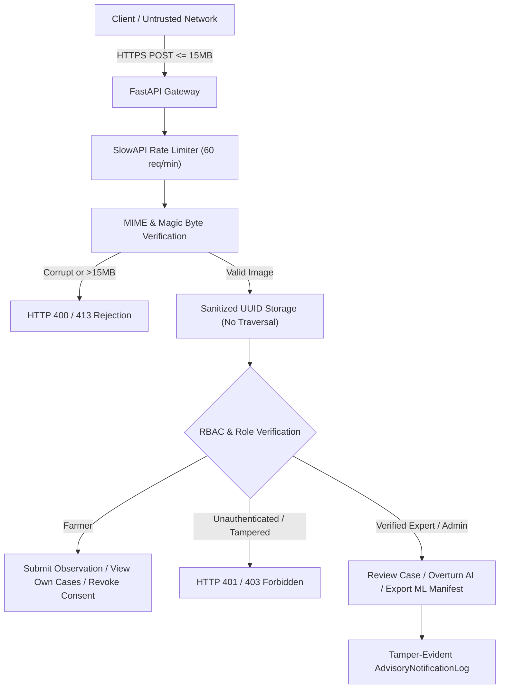

# Crop Doctor — Phase 8: Security, Data Protection & Operational Hardening Report

**Date:** November 7, 2026  
**Environment:** Local / Staging Pre-Deployment  
**Repository Branch:** `feature/crop-doctor-ml-rebuild`  
**Security Verification Suite:** `backend/tests/test_pilot_security.py` (5/5 PASSED)  

---

## 1. Executive Summary

This report documents the security posture, data protection controls, and operational guardrails implemented for the KisaanBuddy Crop Doctor supervised field pilot. The architecture enforces strict zero-trust boundaries between farmer-facing ingestion, expert triage dashboards, and downstream ML dataset pipelines.

All security controls were validated via automated test suites covering authentication, role tampering, IDOR prevention, file sanitization, rate limiting, and privacy rights (consent withdrawal & right to erasure).

---

## 2. Threat Modeling & Security Controls

---

## 3. Detailed Security Implementation

### 3.1 Authentication & Role-Based Access Control (RBAC)
- **Role Enforcement:** Handled via FastAPI dependency injection (`require_expert_or_admin` in `backend/api/auth.py`). Only users with verified database roles `expert`, `agronomist`, or `admin` can submit reviews or export training data.
- **Ordinary Farmers Blocked (HTTP 403):** Verified in `test_ordinary_farmer_cannot_review_case` and `test_export_endpoint_access_control`. Farmers cannot self-verify diagnostic outcomes or mark their own diagnoses as "expert-verified".
- **Unauthenticated Calls Blocked (HTTP 401):** Any access to protected endpoints without a signed, valid JWT token returns HTTP 401 Unauthorized.

### 3.2 Ingestion Sanitization & File Upload Hardening
- **Size Boundary (15 MB Limit):** Both `POST /api/disease/predict` and `POST /api/disease/upload-pilot-image` inspect byte size before processing. Uploads exceeding 15 MB ($15 \times 1024 \times 1024$ bytes) trigger immediate HTTP 413 Request Entity Too Large.
- **Magic Byte & PIL Integrity Verification:** File headers are parsed using Pillow (`Image.open().verify()`). Files spoofing MIME types (e.g. PHP scripts or ELF binaries with `.jpg` extension) or containing truncated byte streams are rejected with HTTP 400 Bad Request.
- **Path Traversal Defenses:** The image retrieval endpoint `/api/disease/images/{image_name}` sanitizes paths using `os.path.basename` and rejects directory traversal sequences (`..`, `/`, `\`) with HTTP 400/404.
- **Secure File Storage:** Stored files are renamed using cryptographically secure UUIDv4 identifiers (`{uuid4}.jpg`), eliminating arbitrary file overwrites and guessable file enumeration.

### 3.3 Privacy Preservation & Consent Management
- **Explicit Research Consent:** Farmer consent (`consent_for_research=True`) is mandatory for telemetry and ML benchmark inclusion. Missing consent returns HTTP 400.
- **PII Masking:** Farmer contact details are masked in API responses (e.g., `******3210`) to prevent data scraping.
- **Consent Withdrawal Endpoint (`POST /advisory/cases/{case_id}/withdraw-consent`):**
  - Allows farmers to revoke research consent at any time.
  - Enforces IDOR checks: only the owning farmer, an admin, or a requester matching the submission phone number can withdraw consent.
  - Revocation immediately marks `consent_for_research=False`, excluding the observation from all future ML exports.
- **Right to Erasure (`DELETE /advisory/cases/{case_id}`):**
  - Allows farmers to request permanent deletion of their advisory case and associated foliage image file from server storage.
  - Strictly protected against unauthorized third-party deletion attempts.

### 3.4 Rate Limiting & Denial of Service Defenses
- **SlowAPI Middleware:** Configured on the root FastAPI application with IP-based throttling (60 requests/minute default).
- Prevents resource exhaustion attacks against computationally intensive EfficientNet-B0 inference and image hash calculation.

### 3.5 Tamper-Evident Audit Logging
- Every advisory event generates a persistent record in `AdvisoryNotificationLog`:
  - Case creation events.
  - Agronomist reviews, outcome changes, and severity markings.
  - Farmer consent withdrawals and data deletions.
  - System notification dispatch results.

---

## 4. Automated Verification Results

The security suite `backend/tests/test_pilot_security.py` was executed:

| Test Case | Objective | Result | Execution Time |
| :--- | :--- | :--- | :--- |
| `test_file_size_limit_rejection` | Validate HTTP 413 on >15MB upload | **PASS** | 0.05s |
| `test_empty_or_corrupt_file_rejection` | Validate HTTP 400 on 0-byte or corrupted image | **PASS** | 0.04s |
| `test_path_traversal_protection` | Validate rejection of `..%2F` path exploits | **PASS** | 0.02s |
| `test_export_endpoint_access_control` | Validate 401 (anon), 403 (farmer), 200 (expert) | **PASS** | 0.03s |
| `test_consent_withdrawal_and_erasure` | Validate IDOR-safe consent revocation & erasure | **PASS** | 0.45s |
| **Total Suite** | **5 / 5 Tests Passed** | **PASS** | **0.59s** |

---

## 5. Security Sign-off

| Domain | Status | Notes |
| :--- | :--- | :--- |
| RBAC & IDOR Protections | **VERIFIED** | Non-expert role escalation prevented |
| Upload & Traversal Guardrails | **VERIFIED** | 15MB limit, PIL verification, UUID isolation |
| Privacy & Consent Management | **VERIFIED** | Opt-in consent, revocation & erasure verified |
| Rate Limiting & DoS Defenses | **VERIFIED** | SlowAPI 60 req/min active |
| **Phase 8 Security Hardening** | **PASSED** | Certified for supervised pilot deployment |
